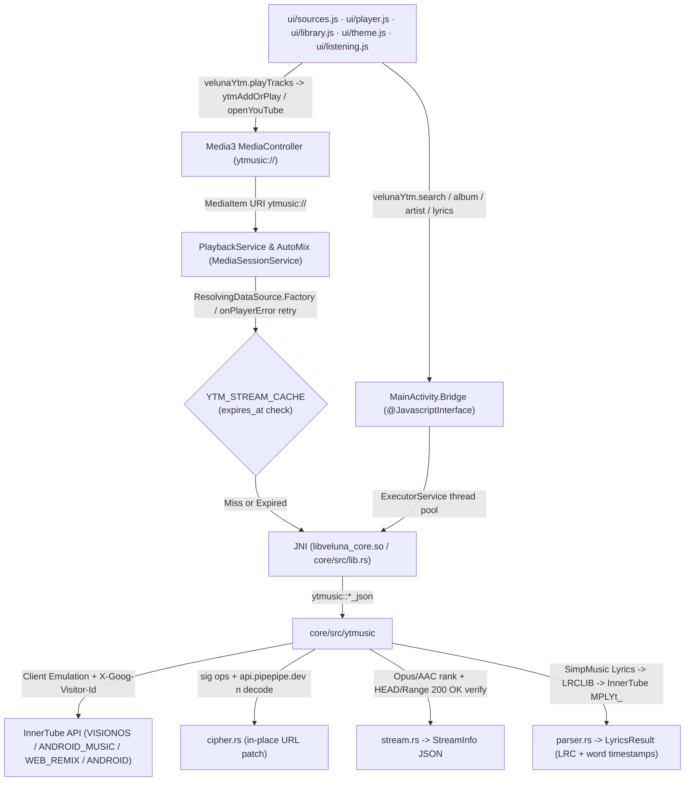

# VelunaMusic — YouTube Music & Liquid Glass UI Handoff (`codex/dev`)

**19 November integration update.** The Windows commands and authenticated LAN references described in the original porting checklist below are implemented on this branch. Windows sends seek requests through a loopback media endpoint and uses the official player when a direct stream is unavailable. Android Remote and Handoff are owned by the playback service when the receiver is enabled. See the dated changelog and bilingual product status for verification and open device tests.

## 1. Architecture Summary

This implementation completes the **Rust InnerTube YouTube Music backend**, **Android Media3 JNI integration**, and **Liquid Glass UI** on branch `codex/dev` without altering `windows/`:

1. **Rust Core (`core/src/ytmusic/`)**
   - Emulates InnerTube clients (`VISIONOS`, `TVHTML5`, `ANDROID_MUSIC`, `WEB_REMIX`, `ANDROID` `21.26.364`) with automatic `X-Goog-Visitor-Id` extraction from `https://music.youtube.com/sw.js_data` (clients & endpoints cross-verified against `SimpMusic-full-arm64-v8a-release.apk`).
   - Discovers active YouTube player hashes (`iframe_api` with `https://api.pipepipe.dev/decoder/latest-player` fallback), fetches player configs (`simpmusic-files` / `faraday` `player_configs.json`) + `base.js`, decodes `signatureCipher` in pure Rust (`CipherOp`: `Reverse`, `Splice`, `Swap`) + `n`-parameter via `api.pipepipe.dev`, and patches URL query params **in-place** so signed tokens (`sparams`/`lsig`) stay intact.
   - Extracts `adaptiveFormats`, prioritizes Opus (`774 > 251 > 250 > 249`) and AAC (`141 > 140 > 139`), verifies stream reachability (`HEAD`, HTTP `Range: bytes=0-16383`, and `&range=0-16383` fallback returning `200 OK`/`206`), caches `StreamInfo` (`url`, `codec`, `bitrate`, `bitrate_kbps`, `sample_rate`, `expires_at`), and provides URL refresh.
   - Supports search with recording variant classification (`Bản gốc` / `Live` / `Remix` / `Cover` / `Instrumental` / `Karaoke`), album/artist `browse`, and multi-tier synced lyrics (`api-lyrics.simpmusic.org` → `lrclib.net` → InnerTube `MPLYt_`).
   - Exported via `core/src/lib.rs` with Android JNI functions `Java_xyz_siloneedsleep_veluna_MainActivity_ytm*`.

2. **Native Android (`android/app/src/main/java/xyz/siloneedsleep/veluna/`)**
   - **`PlaybackService.java`**: Wraps Media3 `ExoPlayer` in `ResolvingDataSource.Factory` (`DefaultMediaSourceFactory`) to resolve `ytmusic://<videoId>` URIs on ExoPlayer's background loader thread, cache stream metadata (`codec`, `bitrate`, `sample_rate`, `expires_at`) in `SharedPreferences("player", 0)` + `YTM_STREAM_CACHE`, and proactively refresh near-expired `googlevideo.com` URLs for uninterrupted screen-off background playback.
   - **`AutoMix.java`**: Reuses `PlaybackService.buildMediaSourceFactory(service)` in `prepareNext()`, invalidates and force-refreshes expired/403 YouTube Music streams in `onPlayerError()` (up to 2 retries per track), and preserves `updateOffload()` so hardware audio offload stays enabled when both EQ and AutoMix are off.
   - **`MainActivity.java`**: Exposes JNI declarations & `@JavascriptInterface` (`ytmSearch`, `ytmStream`, `ytmRefreshStream`, `ytmAlbum`, `ytmArtist`, `ytmLyrics`, `ytmAddOrPlay`), plays `openYouTube(id)` inside `PlaybackService`, handles `ytmusic://` in `readAudio()`, allows YouTube cover CDN hosts (`lh3.googleusercontent.com`, `i.ytimg.com`, `yt3.ggpht.com`) in `shouldInterceptRequest`, and stores metadata locally (never syncing cookies/tokens to Supabase per `.codex/PRODUCT_SPEC.md`).

3. **Liquid Glass Web UI (`ui/`) & Custom Vector Icons (`ui/simpmusic/`)**
   - **4 Liquid Glass Presets (`ui/index.html`, `ui/theme.css`, `ui/theme.js`)**: `clear` (`Kính trong`), `frost` (`Kính mờ`), `dark` (`Kính tối`), `solid` (`Màu đặc`), switchable via quick preset bar `#glass-preset-bar` or `#glass-preset`, with live tint/opacity/blur/border/highlight/shadow/radius/scale/undo-redo controls.
   - **Floating Interactive Mini Player (`#mini-bar`)**: `56px` Liquid Glass capsule (`border-radius: 28px`) with 45° directional specular rim, smoked dark-scrim floor, `saturate(1.5) brightness(1.04)` backdrop vibrancy, `.is-pressed` pointer ripple (`--touch-x`, `--touch-y`, `+2px` blur deepening & subtle spring scale `1.02`), `:hover`, `:focus-visible`, play/next buttons, and collapsible state (`#collapse-mini` ↔ `#mini-expand`).
   - **Shared-Element Spring Transition & Dynamic Cover Palette (`ui/player.js`, `ui/library.js`)**: `velunaMotion.transitionCover` morphs `cover-hero` across album cards (`Home`), `#mini-cover`, and Now Playing `#cover` via `document.startViewTransition` with inline `linear()` spring easing (and explicit `ease-out` fallback), plus focus routing (`#title`). `applyCoverPalette` samples the active cover on a `16×16` canvas to update ambient `--cover-bg-1`, `--cover-bg-2`, and `--cover-accent` (and badge foreground colors via `contrast-color(var(--badge-bg))` + CIE XYZ fallback), paired with `#now-source-badge` and `#now-quality-badge`.
   - **Smooth Line & Word-Timed Lyrics (`ui/lrc.js`, `ui/listening.js`)**: Centers the active lyric line with `scrollTo({ behavior: reduced ? "auto" : "smooth" })`, detects valid word timestamps via `hasWordTiming` + continuous ratio `wordProgress` (`--word-fill`), and avoids fake timeline sweeps when lyrics lack word timestamps.
   - **Reduced Motion & Power Saving (`ui/theme.js`, `ui/theme.css`)**: Dedicated header `#motion-toggle` button + `#motion-level` (`reduced`), plus `#battery-saver` and `#dynamic-cover-bg` toggles. Observes `navigator.getBattery()` (`chargingchange`/`levelchange`) and `document` `visibilitychange` to cap/disable backdrop blur and stop CSS visualizer animations (`#now-visualizer`, `#mini-visualizer`) when running on battery or hidden—without reducing audio playback quality.
   - **Clean Vector Icons (`ui/simpmusic/*.svg`) & `THIRD_PARTY.md`**: Replaced all 12 SVGs (`album`, `favorite`, `home`, `library`, `lyrics`, `next`, `pause`, `play`, `popular`, `previous`, `queue`, `recent`) with original 24×24 geometric vector icons optimized for CSS masking; updated `THIRD_PARTY.md`.

---

## 2. Data Flow Diagram

---

## 3. Remaining Checklist to Port Backend to `windows/` (Tauri)

No files inside `windows/` were modified. To bring `windows/` to parity:

1. **Tauri Commands (`windows/src/main.rs`)**
   - Expose async commands calling `veluna_core::ytmusic::shared_service()`:
     - `ytm_search(query: String, filter: Option<String>)`
     - `ytm_stream(video_id: String, force_refresh: bool)`
     - `ytm_refresh_stream(video_id: String)`
     - `ytm_album(browse_id: String)`
     - `ytm_artist(browse_id: String)`
     - `ytm_lyrics(video_id: String, title: Option<String>, artist: Option<String>, duration_sec: Option<u64>)`
   - Register all 6 commands in `tauri::generate_handler![...]` inside `windows/src/main.rs` (note line 429 origin check enforces `main` window + `tauri.localhost`, matching `ui/` calls).

2. **Playback, CSP & Persistence on Windows**
   - `ui/sources.js` already routes through `desktop.invoke("ytm_*", ...)` when running in Tauri, and `ui/player.js` resolves `ytmusic://` URLs via `velunaYtm.stream` and refreshes on `audio.onerror`.
   - Because `googlevideo.com` URLs can enforce non-browser `User-Agent` matching or reject WebView2 CORS on `<audio>`, implement a lightweight loopback byte-range proxy on `127.0.0.1` inside `windows/src/` forwarding `Range` headers with the matching client `User-Agent` (and add `https://*.googlevideo.com` / loopback origin to `ui/index.html` CSP `media-src`).
   - Persist `ytmusic://<videoId>` tracks in Windows app data (`library.json` or `ytm_library.json`) instead of filtering them out in `open_track()` (`path.is_file()`), and handle `ytmusic://` metadata in `media_tags`, `analyze_audio`, and `open_youtube`.
   - Verify desktop build with `cargo build -p velunamusic` and `cargo test --workspace`.
