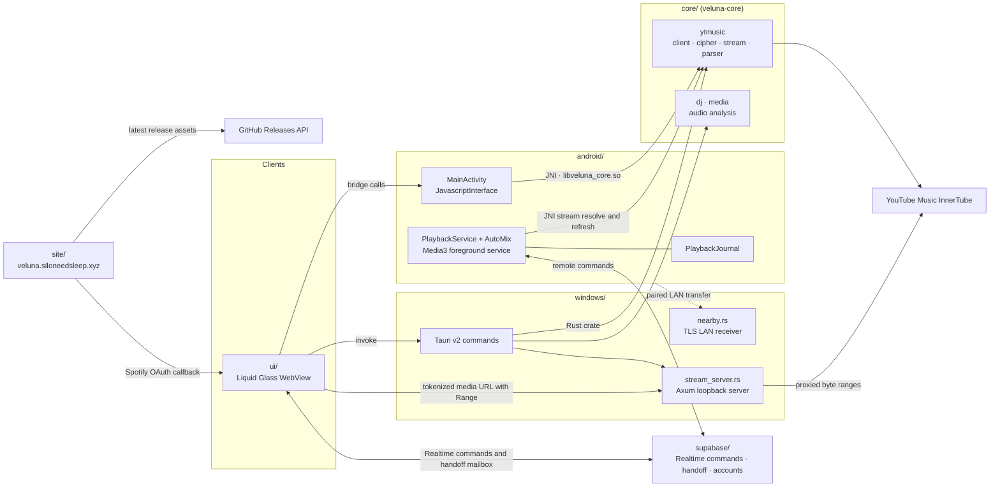

<div align="center">

# VelunaMusic

A cross-platform music player for Android and Windows that combines YouTube Music, a local library, AutoMix and seamless playback handoff on a shared Rust core.

[](#getting-started)
[](core)
[](windows)
[](android)
[](https://veluna.siloneedsleep.xyz)
[](LICENSE)

[Website](https://veluna.siloneedsleep.xyz) · [Product Spec](.codex/PRODUCT_SPEC.md) · [Releases](https://github.com/siloneedsleep/VelunaMusic/releases)

</div>

---

## Status

VelunaMusic is under active development on the `codex/dev` branch. Builds on this branch do not publish installers or create GitHub Releases. Public downloads are enabled only after the complete [product specification](.codex/PRODUCT_SPEC.md), including accounts, handoff and AI DJ, has been validated. The specification is maintained in Vietnamese and English and records which features have been verified on physical devices and which remain open.

## Overview

| Area | Location | Capabilities |
| --- | --- | --- |
| YouTube Music InnerTube engine | `core/src/ytmusic/` | InnerTube client profiles (`WEB_REMIX`, `ANDROID_MUSIC`, `VISIONOS`, `TVHTML5`, `ANDROID`) with automatic `X-Goog-Visitor-Id` retrieval; search with recording variants (original, live, remix, cover, instrumental, karaoke); album and artist browsing; synced and word-timed lyrics; `signatureCipher` and `n`-parameter handling; Opus/AAC format ranking; reachability checks and refresh of expiring stream URLs. |
| Audio analysis and DJ planning | `core/src/dj.rs`, `core/src/media.rs` | Local audio feature extraction with Symphonia (MP3, AAC, MP4, ALAC) and locally bounded transition plans for AutoMix and AI DJ. |
| Android native playback | `android/` | Media3 `ExoPlayer` inside the foreground `PlaybackService`, bridged to Rust through JNI. Screen-off background playback, `ytmusic://` URIs resolved on the loader thread, refresh after expiry or HTTP errors, `AutoMix` crossfade, queue restoration through `PlaybackJournal`, a home-screen widget, and hardware audio offload when both EQ and AutoMix are off. |
| Windows desktop and loopback streamer | `windows/` | Tauri v2 application with tray icon, deep links and single-instance handling. `stream_server.rs` runs an Axum media server on the loopback interface, gated by a random capability token in the URL path, restricted by `Origin`, and forwarding validated single byte ranges for seeking. Credentials are kept in Windows Credential Manager (`vault.rs`). |
| Liquid Glass UI | `ui/` | Shared WebView interface for both platforms. Four glass presets (Clear, Frosted, Tinted Dark, Solid), cover-derived dynamic colors, a floating mini player, shared-element cover transitions, line and word-timed lyrics with per-track offsets, and reduced blur and animation when the window is hidden or the device is on battery. |
| Handoff, remote control and LAN transfer | `supabase/`, `ui/handoff.js`, `ui/remote.js`, `windows/src/nearby.rs`, `NearbyClient.java` | Supabase Realtime remote control and playback handoff between PC and Android. The receiving device must confirm the source is ready before the sender pauses; queue edits carry an operation ID, playback instance and queue version so conflicting changes can be re-selected or discarded. Paired LAN transfer over TLS with mDNS discovery, QR pairing with a pinned certificate fingerprint, and SHA-256 verification. |

Additional sources include offline playlists synchronized by content digest, Spotify account linking (PKCE through a Supabase Edge Function), and a hosted YouTube player fallback for content without a direct stream.

## System Architecture



## Repository Layout

```text
VelunaMusic/
├── core/                  Rust library (veluna-core), built as rlib and cdylib
│   └── src/
│       ├── lib.rs         Public modules and Android JNI exports
│       ├── dj.rs          AutoMix and AI DJ planning
│       ├── media.rs       Audio decoding and feature analysis
│       └── ytmusic/       InnerTube client, cipher, stream selection, parsers, models
├── android/               Gradle project for the Android app
│   └── app/
│       ├── rust.gradle    Cross-compiles veluna-core for each Android ABI
│       └── src/main/java/xyz/siloneedsleep/veluna/
│                          PlaybackService, AutoMix, PlaybackJournal, NearbyClient,
│                          RemotePlayback, NativeHandoff, SecretStore, PlayerWidget, ...
├── windows/               Tauri v2 desktop app (velunamusic crate)
│   └── src/               main.rs, stream_server.rs, nearby.rs, vault.rs, ytmusic.rs
├── ui/                    Shared WebView frontend, also packaged as Android assets
├── site/                  Product website, release downloads, OAuth callback and watch page
├── supabase/              Database migrations and the spotify-link Edge Function
├── tests/                 Node test suites for UI modules, site and release logic
├── .codex/                Product specification
├── .antigravity/          Architecture handoff, API contract and changelog
├── Cargo.toml             Workspace (core, windows)
├── LICENSE                GPL-3.0
└── THIRD_PARTY.md         Upstream adaptations and license notices
```

## Getting Started

### Prerequisites

| Toolchain | Version used by the repository |
| --- | --- |
| Rust | Stable, with Android targets `aarch64-linux-android`, `armv7-linux-androideabi`, `x86_64-linux-android` |
| Java | JDK 17 or newer (CI uses Temurin 17; source and target compatibility are Java 17) |
| Android SDK | Platform `android-35`, Build Tools `35.0.0`, NDK `27.2.12479018` |
| Gradle | 8.10.2 through the bundled wrapper |
| Windows | Rust MSVC toolchain, Visual Studio C++ build tools, WebView2 runtime |
| Node.js | Version with the built-in `node --test` runner |

```sh
rustup target add aarch64-linux-android armv7-linux-androideabi x86_64-linux-android
```

### Build the Windows desktop app

```powershell
cargo build --release --locked --features custom-protocol -p velunamusic
```

For local development, run the app directly:

```powershell
cargo run --locked -p velunamusic --features custom-protocol
```

### Build the Android APK

```sh
./android/gradlew -p android assembleDebug
```

On Windows PowerShell:

```powershell
.\android\gradlew.bat -p android assembleDebug
```

The `preBuild` step runs `rust.gradle`, which builds `libveluna_core.so` for `arm64-v8a`, `armeabi-v7a` and `x86_64` using the NDK clang toolchain, then packages `ui/` as app assets. The debug APK is written to `android/app/build/outputs/apk/debug/app-debug.apk`. The build reads the Supabase URL and publishable key from `ui/cloud-config.js`.

### Running tests

```sh
cargo test --locked --workspace
cargo clippy --workspace --all-targets --locked -- -D warnings
node --test tests/*.test.mjs
```

The `veluna-core` integration tests contact YouTube Music and require network access. The live Supabase isolation test in `tests/` is skipped unless the `VELUNA_QA_ACCOUNTS` environment variable is set. Instrumented Android tests run with `./android/gradlew -p android connectedDebugAndroidTest` on a device or emulator. The CI workflow in `.github/workflows/check.yml` runs the Rust, Windows, Node, Android build and emulator checks.

## Privacy and Security

- **Local identity isolation.** Service sign-in tokens, cookies and personal API keys stay on the device. They are stored in Windows Credential Manager on desktop and in an Android Keystore-backed store on mobile, and are never uploaded to Supabase. Ordinary backups exclude API keys and sign-in tokens.
- **Content integrity.** Local tracks are identified by SHA-256 digests for offline playlist sync and handoff, and LAN transfers are verified against the sender's SHA-256 before they enter the library.
- **Loopback and LAN servers.** The Windows media server binds to the loopback interface, requires a random capability token, rejects foreign origins and accepts only valid single byte ranges. The LAN receiver requires QR pairing, which carries an access token and the fingerprint of the receiver's TLS certificate for pinning.
- **Account data.** Supabase stores accounts, devices, library metadata, handoff state and short-lived remote commands with per-account isolation defined in `supabase/migrations/`.
- **Website.** `site/vercel.json` applies a strict Content Security Policy that limits scripts, styles and images to the site itself and network access to the GitHub API.

## Acknowledgements and License

VelunaMusic is licensed under the [GNU General Public License v3.0](LICENSE). It adapts components and technical references from [SimpMusic](https://github.com/maxrave-dev/SimpMusic) and [PipePipeExtractor](https://github.com/maxrave-dev/PipePipeExtractor), and bundles the Poppins typeface under the SIL Open Font License 1.1. See [THIRD_PARTY.md](THIRD_PARTY.md) for the full list of adaptations and license texts.

Developed by [@siloneedsleep](https://github.com/siloneedsleep).

## Disclaimer

VelunaMusic does not host, store or distribute copyrighted content. Playback is provided by the sources the user connects, subject to each service's terms and the entitlements of the user's account. A VelunaMusic account does not grant Premium features of any third-party service. VelunaMusic is not affiliated with, endorsed by or sponsored by Google, YouTube or Spotify. All trademarks belong to their respective owners.
