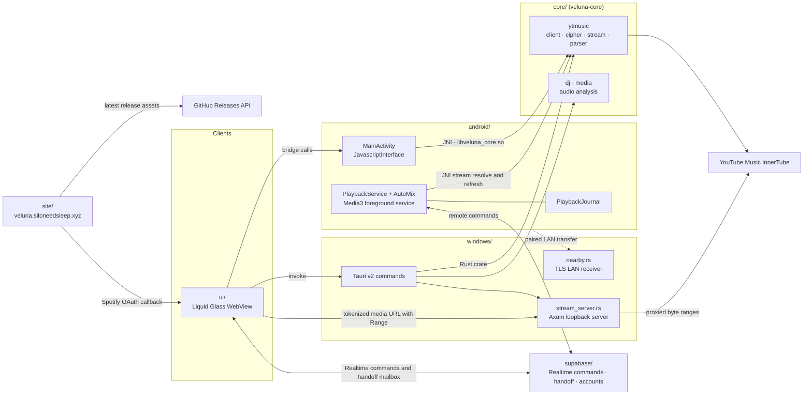

<div align="center">

# VelunaMusic

Trình phát nhạc đa nền tảng cho Android và Windows kết hợp YouTube Music, thư viện nội bộ, AutoMix và chuyển phiên phát liền mạch trên lõi Rust dùng chung.

<p>
  <a href="README.md"></a>
  <a href="README.vi.md"></a>
  &nbsp;
  <a href="https://veluna.siloneedsleep.xyz"></a>
  <a href=".codex/PRODUCT_SPEC.md"></a>
  <a href="https://github.com/siloneedsleep/VelunaMusic/releases"></a>
</p>

<p>
  <a href="#bắt-đầu"></a>
  <a href="core"></a>
  <a href="windows"></a>
  <a href="android"></a>
  <a href="LICENSE"></a>
</p>

</div>

---

## Trạng thái

Các tính năng cốt lõi phát triển trên nhánh `codex/dev` đã được tích hợp vào nhánh chính `main`. Bản phát hành công khai và bộ cài đặt sẽ được mở sau khi hoàn tất nghiệm thu thực tế trên thiết bị vật lý theo [đặc tả sản phẩm](.codex/PRODUCT_SPEC.md), bao gồm tài khoản, chuyển phiên phát (handoff), điều khiển từ xa và AI DJ. Tài liệu đặc tả được duy trì song ngữ Việt – Anh, ghi rõ hạng mục nào đã kiểm chứng trên máy thật và hạng mục nào còn mở.

## Tổng quan

| Thành phần | Vị trí | Chức năng chính |
| --- | --- | --- |
| Lõi YouTube Music InnerTube | `core/src/ytmusic/` | Giả lập các profile client InnerTube (`WEB_REMIX`, `ANDROID_MUSIC`, `VISIONOS`, `TVHTML5`, `ANDROID`) kèm tự động lấy `X-Goog-Visitor-Id`; tìm kiếm phân tách biến thể bản ghi (bản gốc, live, remix, cover, instrumental, karaoke); duyệt album và nghệ sĩ; lời bài hát đồng bộ theo dòng và theo từng từ; xử lý `signatureCipher` và tham số `n`; xếp hạng định dạng Opus/AAC; kiểm tra khả dụng và tự làm mới URL stream khi hết hạn. |
| Phân tích âm thanh & lập kế hoạch DJ | `core/src/dj.rs`, `core/src/media.rs` | Trích xuất đặc trưng âm thanh cục bộ bằng Symphonia (MP3, AAC, MP4, ALAC) và tạo kế hoạch chuyển bài giới hạn cục bộ cho AutoMix và AI DJ. |
| Trình phát Native trên Android | `android/` | Media3 `ExoPlayer` chạy trong Foreground `PlaybackService`, kết nối lõi Rust qua JNI. Hỗ trợ phát ngầm khi tắt màn hình, phân giải URI `ytmusic://` trên loader thread, làm mới luồng khi hết hạn hoặc gặp lỗi HTTP, `AutoMix` crossfade, khôi phục hàng chờ qua `PlaybackJournal`, widget màn hình chính và giữ nguyên đường hardware audio offload khi tắt cả EQ lẫn AutoMix. |
| Ứng dụng Windows & Loopback Streamer | `windows/` | Ứng dụng Tauri v2 tích hợp khay hệ thống (tray icon), deep link và cơ chế single-instance. `stream_server.rs` vận hành media server Axum trên giao diện loopback, bảo vệ bằng capability token ngẫu nhiên trên đường dẫn URL, kiểm soát header `Origin` và chuyển tiếp các single byte range hợp lệ cho thao tác tua mượt mà. Thông tin xác thực được lưu trong Windows Credential Manager (`vault.rs`). |
| Giao diện Liquid Glass | `ui/` | Giao diện WebView dùng chung cho cả hai nền tảng. Hỗ trợ 4 preset kính (Kính trong, Kính mờ, Kính tối, Màu đặc), phối màu động theo ảnh bìa, mini player nổi, chuyển cảnh shared-element cho ảnh bìa, lời bài hát đồng bộ từng dòng và từng từ kèm bù trễ theo từng bài, đồng thời tự hạ blur và hiệu ứng khi cửa sổ bị ẩn hoặc thiết bị chạy pin. |
| Chuyển phiên, Điều khiển từ xa & Truyền LAN | `supabase/`, `ui/handoff.js`, `ui/remote.js`, `windows/src/nearby.rs`, `NearbyClient.java` | Điều khiển từ xa và chuyển phiên phát qua Supabase Realtime giữa PC và Android. Thiết bị nhận phải xác nhận nguồn phát sẵn sàng trước khi máy gửi tạm dừng; mọi chỉnh sửa hàng chờ đính kèm ID thao tác, phiên phát và phiên bản hàng chờ để chọn lại hoặc hủy bỏ khi xung đột. Truyền tệp nội bộ qua mạng LAN sử dụng TLS, khám phá mDNS, ghép đôi mã QR kèm certificate fingerprint pinning và đối chiếu SHA-256. |

Các nguồn và tiện ích bổ sung gồm danh sách phát ngoại tuyến đồng bộ theo hàm băm nội dung, liên kết tài khoản Spotify (PKCE thông qua Supabase Edge Function) và trình phát YouTube nhúng dự phòng cho nội dung không có luồng trực tiếp.

## Kiến trúc hệ thống



## Cấu trúc mã nguồn

```text
VelunaMusic/
├── core/                  Thư viện lõi Rust (veluna-core), biên dịch dạng rlib và cdylib
│   └── src/
│       ├── lib.rs         Các module public và hàm JNI xuất cho Android
│       ├── dj.rs          Lập kế hoạch AutoMix và AI DJ
│       ├── media.rs       Giải mã âm thanh và phân tích đặc trưng
│       └── ytmusic/       Client InnerTube, giải mã cipher, chọn luồng, parser và models
├── android/               Dự án Gradle cho ứng dụng Android
│   └── app/
│       ├── rust.gradle    Biên dịch chéo veluna-core cho từng ABI Android
│       └── src/main/java/xyz/siloneedsleep/veluna/
│                          PlaybackService, AutoMix, PlaybackJournal, NearbyClient,
│                          RemotePlayback, NativeHandoff, SecretStore, PlayerWidget, ...
├── windows/               Ứng dụng desktop Tauri v2 (crate velunamusic)
│   └── src/               main.rs, stream_server.rs, nearby.rs, vault.rs, ytmusic.rs
├── ui/                    Frontend WebView dùng chung, đóng gói thành assets trên Android
├── site/                  Trang giới thiệu sản phẩm, tải bản phát hành, OAuth callback và trang watch
├── supabase/              Các migration cơ sở dữ liệu và Edge Function spotify-link
├── tests/                 Bộ kiểm thử Node cho các module giao diện, trang web và logic release
├── .codex/                Đặc tả sản phẩm song ngữ
├── .antigravity/          Tài liệu bàn giao kiến trúc, hợp đồng API và nhật ký thay đổi
├── Cargo.toml             Rust workspace (core, windows)
├── LICENSE                Giấy phép GPL-3.0
└── THIRD_PARTY.md         Ghi nhận thành phần tham khảo và thông báo giấy phép bên thứ ba
```

## Bắt đầu

### Yêu cầu môi trường

| Công cụ | Phiên bản sử dụng trong dự án |
| --- | --- |
| Rust | Stable, cài sẵn các target Android `aarch64-linux-android`, `armv7-linux-androideabi`, `x86_64-linux-android` |
| Java | JDK 17 trở lên (CI dùng Temurin 17; tương thích mã nguồn và đích biên dịch Java 17) |
| Android SDK | Platform `android-35`, Build Tools `35.0.0`, NDK `27.2.12479018` |
| Gradle | 8.10.2 thông qua Gradle wrapper đi kèm |
| Windows | Toolchain Rust MSVC, Visual Studio C++ Build Tools, WebView2 Runtime |
| Node.js | Phiên bản hỗ trợ sẵn trình chạy `node --test` |

```sh
rustup target add aarch64-linux-android armv7-linux-androideabi x86_64-linux-android
```

### Biên dịch ứng dụng Windows

```powershell
cargo build --release --locked --features custom-protocol -p velunamusic
```

Chạy trực tiếp khi phát triển cục bộ:

```powershell
cargo run --locked -p velunamusic --features custom-protocol
```

### Biên dịch APK Android

```sh
./android/gradlew -p android assembleDebug
```

Trên Windows PowerShell:

```powershell
.\android\gradlew.bat -p android assembleDebug
```

Bước `preBuild` tự động kích hoạt `rust.gradle` để biên dịch `libveluna_core.so` cho cả 3 ABI (`arm64-v8a`, `armeabi-v7a`, `x86_64`) bằng toolchain clang của NDK, sau đó đóng gói `ui/` vào thư mục assets của ứng dụng. Tệp APK debug được xuất tại `android/app/build/outputs/apk/debug/app-debug.apk`. Quá trình biên dịch đọc URL Supabase và publishable key từ `ui/cloud-config.js`.

### Chạy kiểm thử

```sh
cargo test --locked --workspace
cargo clippy --workspace --all-targets --locked -- -D warnings
node --test tests/*.test.mjs
```

Bài test gọi mạng thật tới YouTube Music trong `veluna-core` đã được gắn `#[ignore]` để CI chạy ổn định trên môi trường datacenter. Có thể chạy kiểm tra trực tiếp trên mạng cá nhân bằng lệnh:

```sh
cargo test --locked --manifest-path core/Cargo.toml -- --ignored
```

Bài kiểm thử cô lập tài khoản Supabase trực tiếp trong `tests/` sẽ bị bỏ qua trừ khi thiết lập biến môi trường `VELUNA_QA_ACCOUNTS`. Kiểm thử Android instrumented chạy qua lệnh `./android/gradlew -p android connectedDebugAndroidTest` trên thiết bị thật hoặc trình giả lập. Quy trình CI tại `.github/workflows/check.yml` thực hiện các bước kiểm tra Rust, Windows, Node, biên dịch Android và kiểm thử trên emulator.

## Quyền riêng tư và bảo mật

- **Tách biệt hoàn toàn danh tính cục bộ.** Token đăng nhập dịch vụ, cookie và khóa API cá nhân chỉ lưu cục bộ trên thiết bị — sử dụng Windows Credential Manager trên desktop và kho mã hóa Android Keystore trên di động — tuyệt đối không tải lên Supabase. Các bản sao lưu thông thường tự động loại trừ khóa API và token đăng nhập.
- **Toàn vẹn nội dung bằng SHA-256.** Tệp nhạc nội bộ được định danh bằng mã băm SHA-256 cho đồng bộ playlist ngoại tuyến và chuyển phiên phát; tệp nhận qua mạng LAN được kiểm tra khớp SHA-256 với máy gửi trước khi thêm vào thư viện.
- **Bảo vệ máy chủ loopback và LAN.** Media server trên Windows chỉ lắng nghe trên giao diện loopback, yêu cầu capability token ngẫu nhiên, từ chối mọi `Origin` lạ và chỉ chấp nhận single byte range hợp lệ. Máy nhận LAN bắt buộc ghép đôi mã QR mang theo token truy cập và dấu vân tay chứng chỉ TLS (certificate pinning).
- **Dữ liệu tài khoản.** Supabase chỉ lưu thông tin tài khoản, thiết bị, siêu dữ liệu thư viện, trạng thái chuyển phiên và lệnh điều khiển từ xa ngắn hạn với cơ chế cô lập theo từng tài khoản trong `supabase/migrations/`.
- **Trang web.** `site/vercel.json` áp dụng chính sách Content Security Policy nghiêm ngặt, giới hạn script, style, ảnh về cùng nguồn gốc và chỉ mở kết nối mạng tới GitHub API.

## Ghi nhận mã nguồn mở và giấy phép

VelunaMusic được phát hành theo giấy phép [GNU General Public License v3.0](LICENSE). Dự án kế thừa và tham khảo kỹ thuật từ [SimpMusic](https://github.com/maxrave-dev/SimpMusic) và [PipePipeExtractor](https://github.com/maxrave-dev/PipePipeExtractor), đồng thời tích hợp bộ phông chữ Poppins theo giấy phép SIL Open Font License 1.1. Xem đầy đủ danh sách kế thừa và văn bản giấy phép tại [THIRD_PARTY.md](THIRD_PARTY.md).

Phát triển bởi [@siloneedsleep](https://github.com/siloneedsleep).

## Miễn trừ trách nhiệm

VelunaMusic không lưu trữ, phân phối hay cung cấp nội dung có bản quyền. Việc phát nhạc phụ thuộc hoàn toàn vào các nguồn do người dùng tự kết nối, tuân theo điều khoản dịch vụ và quyền hạn tài khoản tương ứng. Tài khoản VelunaMusic không cấp quyền lợi Premium của bất kỳ dịch vụ bên thứ ba nào. VelunaMusic không trực thuộc, không được xác nhận và không được tài trợ bởi Google, YouTube hay Spotify. Mọi thương hiệu đều thuộc quyền sở hữu của chủ sở hữu tương ứng.
